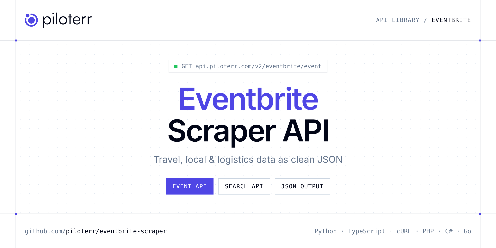

<p align="center">
  <a href="https://www.piloterr.com"></a>
</p>

# Eventbrite Scraper API

[](https://discord.gg/CFj3ph8aHU) [](https://app.piloterr.com) [](https://app.piloterr.com/openapi) [](LICENSE)

The **Piloterr Eventbrite Scraper API** lets you extract public data from Eventbrite as **clean, structured JSON** — no proxies, headless browsers or HTML parsing to maintain. Endpoints available in production:

- **Eventbrite Event API** — Get one Eventbrite event by detail URL or numeric id: venue, organizer, schedule, and description (1 credit).
- **Eventbrite Search API** — Search Eventbrite events by keyword or paste a city/category URL.

Use it for price tracking, review and reputation monitoring, local market research or logistics tracking.

| Endpoint | Path | Credits | What you get |
|---|---|---|---|
| [Eventbrite Event API](#eventbrite-event-api) | `/v2/eventbrite/event` | 1 | Get one Eventbrite event by detail URL or numeric id |
| [Eventbrite Search API](#eventbrite-search-api) | `/v2/eventbrite/search` | 1 | Search Eventbrite events by keyword or paste a city/category URL. Returns event cards and pagination (1 credit). |

## Table of contents

- [How it works](#how-it-works)
- [Eventbrite Event API](#eventbrite-event-api)
- [Eventbrite Search API](#eventbrite-search-api)
- [Code examples in other languages](#code-examples-in-other-languages)
- [Practical use cases](#practical-use-cases)
- [Why Piloterr?](#why-piloterr)
- [FAQ](#faq)
- [Related scrapers](#related-scrapers)
- [Support](#support)

## How it works

1. **Create a free Piloterr account** and copy your API key from the [dashboard](https://app.piloterr.com).
2. **Send a `GET` (or `POST`) request** to `https://api.piloterr.com/v2/...` with the header `x-api-key: YOUR_API_KEY`.
3. **Receive structured JSON** — Piloterr handles rendering, proxies, retries and parsing.

```bash
export PILOTERR_API_KEY="your-api-key"
pip install requests        # Python
# TypeScript: Node.js 18+ (native fetch), run with `npx tsx file.ts`
```

> Every endpoint accepts both `GET` (query string) and `POST` (JSON body with the same fields).

## Eventbrite Event API

Get one Eventbrite event by detail URL or numeric id: venue, organizer, schedule, and description (1 credit).

`GET | POST https://api.piloterr.com/v2/eventbrite/event` · **1 credit per request** · [Full reference](https://app.piloterr.com/openapi)

### Request parameters

| Parameter | Type | Required | Description |
|---|---|---|---|
| `query` | string | ✅ | Event detail URL or numeric id. |
| `domain` | string | — | Country TLD when query is a bare id (`fr`, `com`, `es`, `com.mx`, …). Ignored if query is a full URL. |

### Python example

```python
import json
import os
import requests

response = requests.get(
    "https://api.piloterr.com/v2/eventbrite/event",
    headers={"x-api-key": os.environ["PILOTERR_API_KEY"]},
    params={
        "query": "2002625586037",
    },
    timeout=60,
)
response.raise_for_status()
data = response.json()

print(json.dumps(data, indent=2, ensure_ascii=False)[:2000])
```

### TypeScript example

```typescript
type EventbriteEvent = {
  url?: string;
  name?: string;
  tags?: unknown;
  venue?: {
    id?: string;
    city?: string;
    name?: string;
    region?: string;
    address?: string;
    country?: string;
    latitude?: number;
    longitude?: number;
    postal_code?: unknown;
  };
  domain?: string;
  format?: string;
  images?: string[];
  locale?: string;
  status?: string;
  is_free?: boolean;
  summary?: string;
  category?: string;
  currency?: string;
  end_date?: string;
  event_id?: string;
  timezone?: string;
  image_url?: string;
  is_listed?: boolean;
  is_online?: boolean;
  is_series?: boolean;
  organizer?: {
    id?: string;
    url?: string;
    name?: unknown;
    verified?: boolean;
    num_events?: number;
    total_attendees?: number;
  };
  highlights?: {
    location_type?: string;
    duration_minutes?: number;
  };
  start_date?: string;
  description?: string;
  subcategory?: string;
  [key: string]: unknown;
};

const params = new URLSearchParams({
  "query": "2002625586037",
});

const response = await fetch(`https://api.piloterr.com/v2/eventbrite/event?${params}`, {
  headers: { "x-api-key": process.env.PILOTERR_API_KEY! },
});
if (!response.ok) throw new Error(`Piloterr error ${response.status}: ${await response.text()}`);

const data = (await response.json()) as EventbriteEvent;

console.log(JSON.stringify(data, null, 2).slice(0, 2000));
```

<details>
<summary><b>POST variant</b></summary>

```http
POST https://api.piloterr.com/v2/eventbrite/event
x-api-key: YOUR_API_KEY
Content-Type: application/json

{"query": "2002625586037"}
```
</details>

### Output example

Example response from the API reference, abridged — real values depend on the page you scrape.

```json
{
  "url": "https://www.eventbrite.fr/e/soiree-de-gala-du-festival-international-danimation-dissy-tickets-2002625586037",
  "name": "Soirée de Gala du Festival International d'Animation d'Issy",
  "tags": null,
  "venue": {
    "id": "299647843",
    "city": "Issy-les-Moulineaux",
    "name": "Palais des Arts et des Congrès d'Issy",
    "region": "IDF",
    "address": "25 Avenue Victor Cresson, 92130 Issy-les-Moulineaux",
    "country": "FR",
    "latitude": 48.8229941,
    "longitude": 2.2699164,
    "postal_code": null
  },
  "domain": "fr",
  "format": "Festival",
  "images": [
    "https://img.evbuc.com/cover.jpg"
  ],
  "locale": "fr_FR",
  "status": "live",
  "is_free": true,
  "summary": "Une occasion unique de plonger dans l’univers fascinant des films d’animation chinois.",
  "category": "Film & Media",
  "currency": "EUR",
  "end_date": "2026-10-09T22:30:00",
  "event_id": "2002625586037",
  "timezone": "Europe/Paris",
  "image_url": "https://img.evbuc.com/cover.jpg",
  "is_listed": true,
  "is_online": false,
  "is_series": false,
  "organizer": {
    "id": "112804898271",
    "url": "https://www.eventbrite.fr/o/112804898271",
    "name": null,
    "verified": false,
    "num_events": 11,
    "total_attendees": 911
  },
  "highlights": {
    "location_type": "in_person",
    "duration_minutes": 150
  },
  "start_date": "2026-10-09T20:00:00",
  "description": "<p>Assistez à la première édition…</p>",
  "subcategory": "Film"
}
```

### Response fields

| Field | Type | Description |
|---|---|---|
| `url` | string |  |
| `name` | string |  |
| `tags` | object |  |
| `venue` | object |  |
| `venue.id` | string |  |
| `venue.city` | string |  |
| `venue.name` | string |  |
| `venue.region` | string |  |
| `venue.address` | string |  |
| `venue.country` | string |  |
| `venue.latitude` | number |  |
| `venue.longitude` | number |  |
| `venue.postal_code` | object |  |
| `domain` | string |  |
| `format` | string |  |
| `images` | string[] |  |
| `locale` | string |  |
| `status` | string |  |
| `is_free` | boolean |  |
| `summary` | string |  |
| `category` | string |  |
| `currency` | string |  |
| `end_date` | string |  |
| `event_id` | string |  |
| `timezone` | string |  |

## Eventbrite Search API

Search Eventbrite events by keyword or paste a city/category URL. Returns event cards and pagination (1 credit).

`GET | POST https://api.piloterr.com/v2/eventbrite/search` · **1 credit per request** · [Full reference](https://app.piloterr.com/openapi)

### Request parameters

| Parameter | Type | Required | Description |
|---|---|---|---|
| `query` | string | — | Keyword, or paste a full Eventbrite city / category / search URL. |
| `domain` | string | — | Eventbrite TLD when query is a keyword (`fr`, `com`, `es`, `com.mx`, `co.uk`, …). Ignored if query is a full URL. |
| `location` | string | — | Location slug such as `france--paris` (keyword searches only). |
| `page` | number | — | Page number. |

### Python example

```python
import json
import os
import requests

response = requests.get(
    "https://api.piloterr.com/v2/eventbrite/search",
    headers={"x-api-key": os.environ["PILOTERR_API_KEY"]},
    params={
        "query": "rock",
    },
    timeout=60,
)
response.raise_for_status()
data = response.json()

print(json.dumps(data, indent=2, ensure_ascii=False)[:2000])
```

### TypeScript example

```typescript
type EventbriteSearch = {
  results?: {
    url?: string;
    name?: string;
    tags?: string[];
    venue?: {
      id?: string;
      city?: string;
      name?: string;
      region?: string;
      address?: string;
      country?: string;
      latitude?: number;
      longitude?: number;
      postal_code?: string;
    };
    summary?: string;
    end_date?: string;
    end_time?: string;
    event_id?: string;
    language?: string;
    timezone?: string;
    image_url?: string;
    is_online?: boolean;
    start_date?: string;
    start_time?: string;
    tickets_url?: string;
    organizer_id?: string;
  }[];
  pagination?: {
    next?: string;
    page?: number;
    per_page?: number;
    total_pages?: number;
    total_results?: number;
  };
};

const params = new URLSearchParams({
  "query": "rock",
});

const response = await fetch(`https://api.piloterr.com/v2/eventbrite/search?${params}`, {
  headers: { "x-api-key": process.env.PILOTERR_API_KEY! },
});
if (!response.ok) throw new Error(`Piloterr error ${response.status}: ${await response.text()}`);

const data = (await response.json()) as EventbriteSearch;

console.log(JSON.stringify(data, null, 2).slice(0, 2000));
```

<details>
<summary><b>POST variant</b></summary>

```http
POST https://api.piloterr.com/v2/eventbrite/search
x-api-key: YOUR_API_KEY
Content-Type: application/json

{"query": "rock"}
```
</details>

### Output example

Example response from the API reference, abridged — real values depend on the page you scrape.

```json
{
  "results": [
    {
      "url": "https://www.eventbrite.com/e/paris-classical-concert-ave-maria-alleluia-tickets-1999267177948",
      "name": "Paris Classical Concert – Ave Maria & Alleluia",
      "tags": [
        "Classical",
        "Music"
      ],
      "venue": {
        "id": "299211756",
        "city": "Paris",
        "name": "Église de la Madeleine",
        "region": "IDF",
        "address": "Place de la Madeleine, 75008 Paris",
        "country": "FR",
        "latitude": 48.8700435,
        "longitude": 2.3245502,
        "postal_code": "75008"
      },
      "summary": "Experience Ave Maria & Alleluia live at La Madeleine Church, Paris.",
      "end_date": "2026-10-22",
      "end_time": "21:15",
      "event_id": "1999267177948",
      "language": "en-gb",
      "timezone": "Europe/Paris",
      "image_url": "https://img.evbuc.com/cover.jpg",
      "is_online": false,
      "start_date": "2026-10-22",
      "start_time": "20:00",
      "tickets_url": "https://www.eventbrite.com/checkout-external?eid=1999267177948",
      "organizer_id": "121326821059"
    }
  ],
  "pagination": {
    "next": "https://www.eventbrite.com/d/france--paris/rock/?page=2",
    "page": 1,
    "per_page": 20,
    "total_pages": 12,
    "total_results": 230
  }
}
```

### Response fields

| Field | Type | Description |
|---|---|---|
| `results[]` | object[] |  |
| `results[].url` | string |  |
| `results[].name` | string |  |
| `results[].tags` | string[] |  |
| `results[].venue` | object |  |
| `results[].summary` | string |  |
| `results[].end_date` | string |  |
| `results[].end_time` | string |  |
| `results[].event_id` | string |  |
| `results[].language` | string |  |
| `results[].timezone` | string |  |
| `results[].image_url` | string |  |
| `results[].is_online` | boolean |  |
| `results[].start_date` | string |  |
| `results[].start_time` | string |  |
| `results[].tickets_url` | string |  |
| `results[].organizer_id` | string |  |
| `pagination` | object |  |
| `pagination.next` | string |  |
| `pagination.page` | integer |  |
| `pagination.per_page` | integer |  |
| `pagination.total_pages` | integer |  |
| `pagination.total_results` | integer |  |

## Code examples in other languages

Ready-to-run examples live in the [`examples/`](examples) folder. Each one reads your key from the `PILOTERR_API_KEY` environment variable.

| Language | Event | Search |
|---|---|---|
| cURL (Bash) | [`event`](examples/curl/event.sh) | [`search`](examples/curl/search.sh) |
| PHP | [`event`](examples/php/event.php) | [`search`](examples/php/search.php) |
| C# | [`event`](examples/csharp/Event.cs) | [`search`](examples/csharp/Search.cs) |
| Go | [`event`](examples/go/event.go) | [`search`](examples/go/search.go) |
| Java | [`event`](examples/java/EventExample.java) | [`search`](examples/java/SearchExample.java) |
| Ruby | [`event`](examples/ruby/event.rb) | [`search`](examples/ruby/search.rb) |
| Node.js | [`event`](examples/nodejs/event.mjs) | [`search`](examples/nodejs/search.mjs) |

## Practical use cases

- **Price tracking** — Monitor rates and offers over time.
- **Reputation monitoring** — Track ratings and reviews of venues and competitors.
- **Local market research** — Map businesses, venues and events by area.
- **Logistics visibility** — Follow shipments and statuses where available.
- **Travel products** — Power comparison tools and alerts with structured data.

## Why Piloterr?

- **No infrastructure** — no proxies, headless browsers or CAPTCHA solving to run yourself.
- **Structured JSON** — stable, documented fields instead of brittle HTML selectors.
- **Pay per request** — transparent credit cost per endpoint, failed requests are retried for you.
- **One API key, hundreds of sources** — Eventbrite plus many other e-commerce, search and company data endpoints in the [Piloterr library](https://www.piloterr.com/library).
- **Any language** — plain HTTPS + JSON, with examples for Python, TypeScript, cURL, PHP, C#, Go, Java, Ruby and Node.js.

## FAQ

### Is it legal to scrape Eventbrite?

Collecting publicly available data is generally allowed in many jurisdictions, but rules depend on your country, the data you collect and how you use it. Avoid personal data unless you have a lawful basis, respect the website's terms where they apply, and get legal advice for your specific use case. This is not legal advice.

### Do I need proxies or a headless browser?

No. Piloterr handles rendering, proxy rotation and retries on its side. You only send an HTTPS request with your `x-api-key` header and receive JSON.

### How much does a request cost?

Credits per call: `/v2/eventbrite/event` **1**, `/v2/eventbrite/search` **1**. See the [Piloterr website](https://www.piloterr.com) for plans.

### What data does the Eventbrite API return?

Each endpoint returns structured JSON: **Eventbrite Event** — `url`, `name`, `tags`, `venue`, `venue.id`, `venue.city`; **Eventbrite Search** — `results[]`, `results[].url`, `results[].name`, `results[].tags`, `results[].venue`, `results[].summary`.

### How do I paginate Eventbrite results?

Use the `page` parameter and keep requesting while the response indicates more results.

### Can I target a specific country or language?

Yes, use `domain` — see the parameter tables above for accepted values.

### Which languages are supported?

Any language that can make an HTTP request. This README shows Python and TypeScript; the [`examples/`](examples) folder contains cURL, PHP, C#, Go, Java, Ruby and Node.js.

## Related scrapers

- [Auto Europe Scraper API](https://github.com/piloterr/autoeurope-scraper)
- [Expedia Scraper API](https://github.com/piloterr/expedia-scraper)
- [Maersk Scraper API](https://github.com/piloterr/maersk-scraper)
- [TheFork Scraper API](https://github.com/piloterr/thefork-scraper)
- [Yelp Scraper API](https://github.com/piloterr/yelp-scraper)
- [All Piloterr scrapers on GitHub](https://github.com/piloterr)

## Support

- 💬 Join the [Piloterr Discord](https://discord.gg/CFj3ph8aHU) to ask questions and share what you build.
- 📚 Browse the [API reference (OpenAPI)](https://app.piloterr.com/openapi) and the [Piloterr library](https://www.piloterr.com/library).
- 🔑 [Get your API key](https://app.piloterr.com).

---

<p align="center">
  <a href="https://www.piloterr.com">
    <picture>
      <source media="(prefers-color-scheme: dark)" srcset="images/logo-dark.svg">
      
    </picture>
  </a>
  <br>
  <sub>Built by <a href="https://www.piloterr.com">Piloterr</a> — web scraping APIs for e-commerce, search, real estate and more, one API key.</sub>
</p>

<sub>Eventbrite is a trademark of its respective owner. This repository is not affiliated with or endorsed by Eventbrite. Examples are released under the MIT license.</sub>
